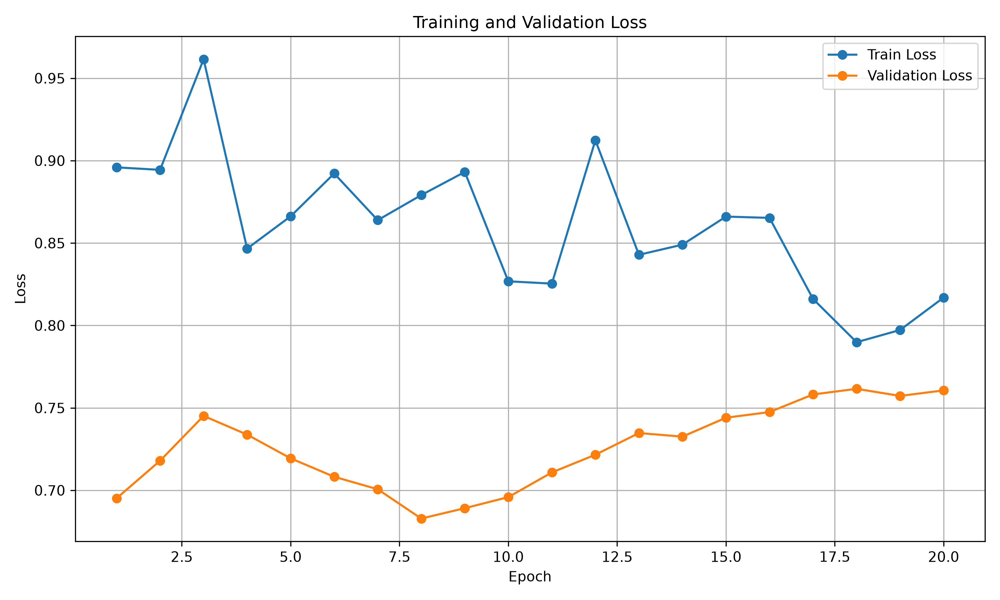
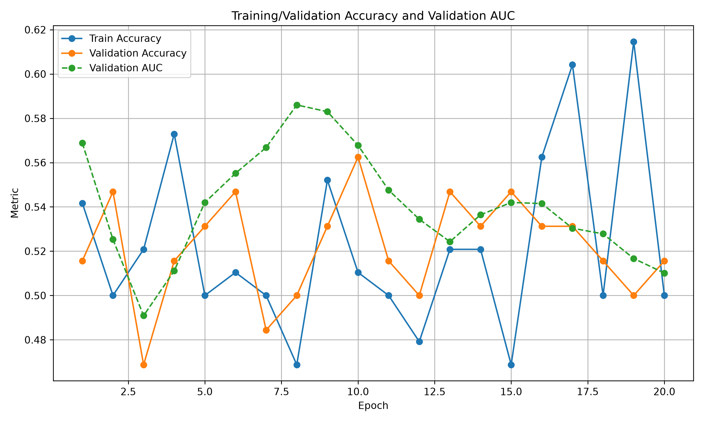

# Final Training Report

## System & Model Configuration
- **Backbone Architecture:** EfficientNet-B0
- **Optimizer:** AdamW
- **Learning Rate:** 1e-4 (with CosineAnnealingLR)
- **FP16 AMP:** Enabled (torch.amp.autocast, GradScaler)
- **Total Epochs Run:** 20

## Peak Performance Table
| Metric | Value |
| --- | --- |
| Best Epoch | 10 |
| Best Validation Accuracy | 0.5625 |
| Best Validation Loss | 0.6959 |
| Best Validation AUC | 0.5678 |

## Convergence Assessment
- **Validation loss trend:** Increasing
- **Training loss trend:** Decreasing
- **Warning:** Potential overfitting detected (Validation loss increasing while training loss decreases).

## Learning Curves
### Loss Curve

### Accuracy & AUC Curve

